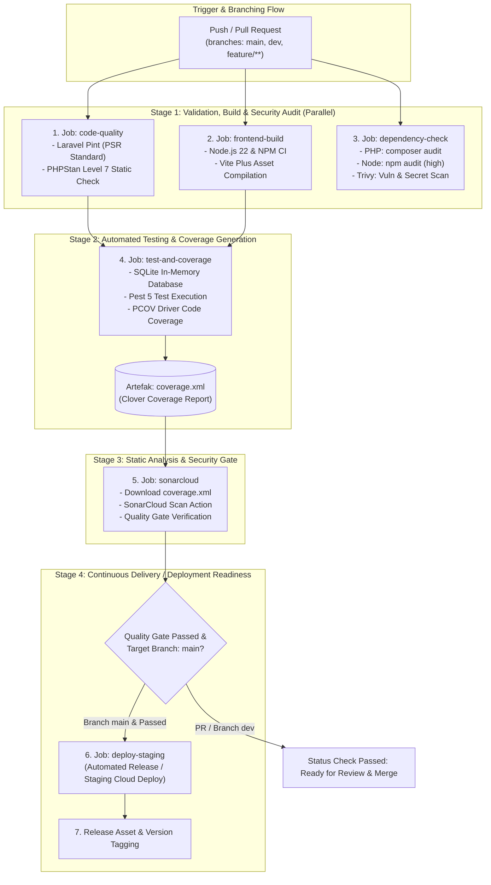
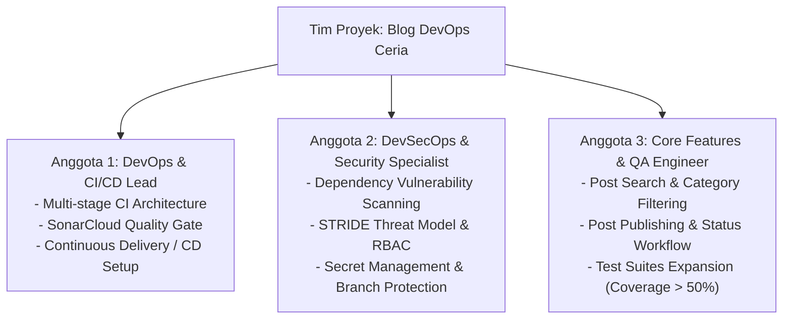

# Rencana Strategis & Master Plan CI/CD Pipeline (DevOps - UTS 25262)

Dokumen ini memuat perencanaan strategis, arsitektur, dan tahapan implementasi pipeline **Continuous Integration & Continuous Deployment (CI/CD)** serta **DevSecOps** untuk proyek **Blog DevOps Ceria**. Dokumen ini disusun berdasarkan seluruh persyaratan dan rubrik penilaian **Ujian Tengah Semester (UTS) Mata Kuliah DevOps (CCK4IBB3)** Program Studi S1 Rekayasa Perangkat Lunak, Telkom University.

---

## 1. Ringkasan Eksekutif & Sasaran Mutu

### 1.1 Tujuan Proyek
Membangun alur otomatisasi *software delivery lifecycle* berbasis *Continuous Integration* (CI) dan *Continuous Deployment* (CD) yang andal, aman, teruji secara komprehensif, dan memenuhi standar praktik DevSecOps modern.

### 1.2 Target Skor Rubrik UTS
Perencanaan ini dirancang untuk mencapai predikat **Sangat Baik (Skor 4 / Nilai Maksimal)** pada seluruh komponen evaluasi:
- **Rubrik 1 (Implementasi Pipeline CI - Bobot 15%)**: Pipeline multi-stage (Build, Test, DevSecOps, Code Analysis), YAML terstruktur & best practice, otomatisasi pengujian dengan code coverage > 50%, dan integrasi otomatis SonarQube/SonarCloud.
- **Rubrik 2 (Perubahan Aplikasi & Kualitas Kode - Bobot 10%)**: Minimal > 3 perubahan fungsional signifikan per anggota, zero bugs & zero vulnerabilities pada SonarQube, dan > 3 test cases per fitur yang mencakup *edge cases*.
- **Rubrik 3 (DevSecOps - Bobot 10%)**: Analisis STRIDE lengkap pada 6 kategori, automated dependency security check (`composer audit` dan `npm audit`), *secret management* tanpa *hardcoded credentials*, serta penerapan *Branch Protection Rules* dan *mandatory code review*.
- **Rubrik 4 (Dokumentasi & Laporan - Bobot 10%)**: Laporan 7 bagian lengkap dan terstruktur, video demonstrasi YouTube proporsional, serta analisis retrospektif tim yang mendalam.
- **Rubrik 5 (Presentasi & Demonstrasi - Bobot 5%)**: Penguasaan materi, demo lancar, dan kontribusi individual yang terdefinisi jelas.

---

## 2. Matriks Pemetaan Kebutuhan & Target Capaian

| No | Komponen Rubrik | Target Kualifikasi (Skor 4) | Rencana Implementasi Teknis | Output / Bukti Verifikasi |
|:---:|:---|:---|:---|:---|
| 1 | **Arsitektur Pipeline CI** | Pipeline multi-stage berjalan otomatis pada push & PR di branch `main`, `dev`, dan `feature/**` | Dikonfigurasi di `.github/workflows/ci.yml` dengan 5 jobs terisolasi dan sistem dependency caching | Pipeline status badge, execution history hijau di GitHub Actions |
| 2 | **Format & Standar YAML** | YAML terstruktur, modular, maintainable, zero-syntax error, best practice | Pemisahan jobs, penggunaan actions resmi (`actions/checkout@v4`, `shivammathur/setup-php@v2`, dll.) | File `.github/workflows/ci.yml` |
| 3 | **Automated Testing & Coverage** | Pengujian otomatis berjalan di CI dengan code coverage > 50% | Menjalankan Pest 5 dengan driver PCOV untuk menghasilkan `coverage.xml` | Laporan coverage di SonarCloud & summary artifact Pest |
| 4 | **Analisis SonarQube** | SonarQube berjalan otomatis di pipeline, memantau bugs, vulnerabilities, dan Quality Gate | Integrasi `sonarsource/sonarqube-scan-action@v5` dan konfigurasi `sonar-project.properties` | Dashboard SonarCloud dengan status **PASSED** |
| 5 | **Kontribusi Perubahan Kode** | > 3 perubahan signifikan per anggota tim (fitur / function baru) | Pembagian modul kerja jelas pada Blog, Category, User, dan Security | Commit history Git, PR individual, rincian per anggota |
| 6 | **Kualitas Kode** | 0 Bugs, 0 Vulnerabilities, Security Hotspots reviewed, Code Smells minimal | Penegakan Laravel Pint dan static analysis Larastan/PHPStan Level 7 | Laporan analisis SonarCloud & build log |
| 7 | **Kelengkapan Test Cases** | > 3 test cases per fitur yang mencakup skenario positif, negatif, dan *edge cases* | Pembuatan unit & feature test suites menggunakan Pest 5 | Direktori `tests/Feature/` dan `tests/Unit/` |
| 8 | **Threat Modeling STRIDE** | Semua 6 kategori dianalisis dengan ancaman spesifik aplikasi dan mitigasi nyata | Pemetaan arsitektur Blog DevOps Ceria terhadap risiko STRIDE | Dokumen `docs/threat-modeling-stride.md` |
| 9 | **Dependency Check & Security Scan** | Pemindaian kerentanan dependensi dan audit keamanan repository otomatis | Eksekusi `composer audit`, `npm audit`, dan Trivy Security Scanner (vulnerability & secret) | Job `dependency-check` pada workflow CI |
| 10 | **Secret Management** | Zero hardcoded credentials, isolasi `.env`, penggunaan GitHub Secrets | Penggunaan `secrets.SONAR_TOKEN`, `secrets.APP_KEY`, `.env.example` | File `.gitignore`, audit repo, secret configuration |
| 11 | **Branch Protection & Review** | Proteksi branch `main`, wajib Pull Request, minimal 1 reviewer approval | Konfigurasi GitHub Branch Protection rules & status checks wajib | Pengaturan repository GitHub & riwayat PR |
| 12 | **Dokumentasi & Laporan** | Laporan lengkap 7 bagian, video YouTube, retrospektif mendalam | Penyusunan laporan berdasarkan template resmi | Dokumen `docs/laporan-uts-template.md` & tautan YouTube |

---

## 3. Arsitektur Target Pipeline CI/CD



---

## 4. Rincian Teknis Jobs Pipeline

### 4.1 Job 1: `code-quality` (Format & Static Analysis)
- **Runner**: `ubuntu-latest`
- **Tujuan**: Menjamin keseragaman format kode sesuai standar PSR-12/Laravel serta mendeteksi potensi bug logika melalui analisis tipe data statis.
- **Langkah Utama**:
  1. *Checkout repository* via `actions/checkout@v4`.
  2. Setup PHP 8.4 dengan ekstensi minimum via `shivammathur/setup-php@v2`.
  3. Menggunakan `actions/cache@v4` untuk direktori `vendor/` berdasarkan hash `composer.lock`.
  4. Menjalankan `vendor/bin/pint --test` untuk verifikasi formatting tanpa menulis file.
  5. Menjalankan `vendor/bin/phpstan analyse --memory-limit=1G` untuk analisis statis tingkat tinggi (Level 7).

### 4.2 Job 2: `frontend-build` (Asset Compilation)
- **Runner**: `ubuntu-latest`
- **Tujuan**: Memastikan aset frontend, Tailwind CSS v4, dan dependensi client-side berhasil di-bundle tanpa *build error*.
- **Langkah Utama**:
  1. Setup Node.js v22 dengan caching npm aktif via `actions/setup-node@v4`.
  2. Menjalankan `npm ci` untuk instalasi dependensi deterministik.
  3. Menjalankan `npm run build` menggunakan Vite Plus (`vp build`).

### 4.3 Job 3: `dependency-check` (DevSecOps Audit & Security Scan)
- **Runner**: `ubuntu-latest`
- **Tujuan**: Memeriksa seluruh paket pihak ketiga terhadap basis data kerentanan keamanan publik (*Vulnerability Database*) serta memindai repositori dari potensi kebocoran *secret/credential*.
- **Langkah Utama**:
  1. Audit PHP: `composer audit --locked` (memeriksa database Packagist / CVE).
  2. Audit Node: `npm audit --audit-level=high` (memeriksa risiko tingkat *high* dan *critical*).
  3. Security & Vulnerability Scan: `aquasecurity/trivy-action@v0.36.0` (memindai kerentanan dependensi filesystem serta hardcoded secrets).

### 4.4 Job 4: `test-and-coverage` (Automated Testing & Coverage)
- **Runner**: `ubuntu-latest`
- **Prasyarat**: Menunggu penyelesaian `code-quality` dan `frontend-build`.
- **Tujuan**: Mengeksekusi seluruh pengujian fungsional dan mengukur tingkat *code coverage*.
- **Langkah Utama**:
  1. Setup PHP 8.4 dengan ekstensi `pcov`, `pdo_sqlite`, `intl`, `mbstring`.
  2. Inisialisasi basis data SQLite dan eksekusi migrasi: `php artisan migrate --force`.
  3. Eksekusi pengujian Pest: `vendor/bin/pest --coverage --coverage-clover=coverage.xml`.
  4. Unggah artefak `coverage.xml` via `actions/upload-artifact@v4` dengan retensi 7 hari.

### 4.5 Job 5: `sonarcloud` (Quality Gate & SAST)
- **Runner**: `ubuntu-latest`
- **Prasyarat**: Menunggu penyelesaian `test-and-coverage`.
- **Tujuan**: Pemindaian kualitas kode menyeluruh (Bugs, Vulnerabilities, Hotspots, Code Smells, Duplication, dan Coverage).
- **Langkah Utama**:
  1. Unduh artefak `coverage.xml` via `actions/download-artifact@v4`.
  2. Jalankan `sonarsource/sonarqube-scan-action@v5`.
  3. Validasi status *Quality Gate* berbasis ruleset SonarCloud.

### 4.6 Job 6: `cd-staging-readiness` (Continuous Deployment Planning)
- **Runner**: `ubuntu-latest`
- **Kondisi Eksekusi**: Hanya aktif pada event `push` ke branch `main` setelah seluruh jobs sebelumnya sukses.
- **Tujuan**: Memverifikasi kesiapan artefak untuk deployment produksi/staging ke platform cloud (misal Laravel Cloud, Docker Registry, atau VPS).

---

## 5. Rencana Pembagian Tugas & Kontribusi Perubahan Anggota

Sesuai regulasi, setiap anggota wajib melakukan minimal **3 perubahan signifikan** (fitur/function baru) dan membuat **minimal > 3 test cases** per fitur mencakup *edge cases*.



### 5.1 Anggota 1: DevOps & CI/CD Lead
- **Fokus Utama**: Arsitektur Pipeline CI/CD, Caching, Integrasi SonarCloud, dan Mekanisme Deployment.
- **Rencana 3 Perubahan Aplikasi (Fitur / Function)**:
  1. *Perubahan 1*: Implementasi Multi-stage CI Pipeline dengan dependency caching (Composer & NPM) dan passing artifact XML.
  2. *Perubahan 2*: Integrasi SonarCloud Scanner dengan kustomisasi parameter `sonar-project.properties` dan setup Quality Gate.
  3. *Perubahan 3*: Penambahan endpoint API Health Check (`/api/health`) untuk memantau status aplikasi, database, dan cache secara otomatis di CI/CD.
- **Rencana Test Cases (> 3 test cases per fitur)**:
  - `HealthCheckTest`: Verifikasi status database SQLite responsif (`status: ok`).
  - `HealthCheckTest`: Verifikasi penanganan saat cache driver tidak tersedia.
  - `HealthCheckTest`: Verifikasi struktur response JSON dan HTTP status code (200 vs 503).

### 5.2 Anggota 2: DevSecOps & Security Specialist
- **Fokus Utama**: Threat Modeling STRIDE, Dependency Scanning, Secret Management, dan Otorisasi RBAC.
- **Rencana 3 Perubahan Aplikasi (Fitur / Function)**:
  1. *Perubahan 1*: Implementasi automated dependency audit & security scanning di pipeline (`composer audit`, `npm audit`, dan Trivy scanner).
  2. *Perubahan 2*: Penegakan Role-Based Access Control (RBAC) pada manajemen user dan proteksi aksi administratif (kolom `role` pada `users`).
  3. *Perubahan 3*: Implementasi Rate Limiting proteksi brute force login via Fortify dan penutupan *information disclosure* pada HTTP responses.
- **Rencana Test Cases (> 3 test cases per fitur)**:
  - `SecurityRBACTest`: User biasa (`role: user`) dilarang mengakses halaman admin (403 Forbidden).
  - `SecurityRBACTest`: Admin (`role: admin`) memiliki akses penuh ke manajemen artikel dan kategori.
  - `SecurityRBACTest`: Pencegahan eskalasi hak akses (*mass assignment*) saat update profil pengguna.
  - `AuthThrottleTest`: Pembatasan request login setelah 5 kali percobaan gagal (429 Too Many Requests).

### 5.3 Anggota 3: Core Features & QA Engineer
- **Fokus Utama**: Peningkatan Fungsionalitas Blog, Validasi Komponen Livewire, dan Peningkatan Code Coverage.
- **Rencana 3 Perubahan Aplikasi (Fitur / Function)**:
  1. *Perubahan 1*: Fitur pencarian artikel dinamis (*real-time search*) dan filter kategori pada halaman publik blog.
  2. *Perubahan 2*: Fitur manajemen status publikasi artikel (*Draft*, *Published*, *Archived*) beserta tanggal tayang.
  3. *Perubahan 3*: Optimasi query Eloquent (pencegahan N+1 query) dan pagination data artikel dengan Livewire.
- **Rencana Test Cases (> 3 test cases per fitur)**:
  - `BlogSearchTest`: Menampilkan hasil pencarian artikel berdasarkan kata kunci judul.
  - `BlogSearchTest`: Menampilkan notifikasi "Artikel tidak ditemukan" ketika keyword tidak cocok (*edge case*).
  - `PostStatusTest`: Pengunjung publik tidak dapat melihat artikel berstatus *Draft*.
  - `PostStatusTest`: Admin dapat mengubah status artikel dari *Draft* menjadi *Published*.
  - `PostStatusTest`: Validasi kegagalan simpan jika slug artikel sudah digunakan (*duplicate slug edge case*).

---

## 6. Jadwal & Tahapan Eksekusi (Phased Milestones)

| Fase | Target Waktu | Aktivitas Utama | Output / Deliverable |
|:---:|:---|:---|:---|
| **Fase 1** | Minggu 1 | - Konfigurasi baseline CI pipeline multi-stage (`.github/workflows/ci.yml`).<br/>- Setup dependency cache Composer & NPM.<br/>- Konfigurasi linting Laravel Pint dan static analysis PHPStan Level 7. | Pipeline dasar lulus pada push/PR |
| **Fase 2** | Minggu 2 | - Integrasi SonarCloud Scanner dan token repository.<br/>- Konfigurasi `sonar-project.properties` dan isolasi file coverage.<br/>- Pengujian generate artefak `coverage.xml` via PCOV. | Dashboard SonarCloud aktif & Quality Gate terhubung |
| **Fase 3** | Minggu 3 | - Implementasi 3 perubahan kode per anggota tim.<br/>- Penulisan test cases komprehensif menggunakan Pest 5 (unit & feature).<br/>- Peningkatan target coverage hingga melampaui 50%. | 9+ fitur/perubahan ter-commit dengan test cases hijau |
| **Fase 4** | Minggu 4 | - Analisis STRIDE Threat Modeling menyeluruh.<br/>- Integrasi audit keamanan dependensi otomatis di pipeline.<br/>- Pengaturan GitHub Secrets dan verifikasi zero-hardcoded credentials.<br/>- Penerapan GitHub Branch Protection Rules pada branch `main`. | Audit DevSecOps lulus, proteksi branch aktif |
| **Fase 5** | Minggu 5 | - Uji coba end-to-end simulasi Pull Request dan merge.<br/>- Penyusunan dokumen Laporan UTS 7 Bagian.<br/>- Perekaman dan editing video demonstrasi YouTube.<br/>- Finalisasi retrospektif tim. | Laporan final, tautan video YouTube siap submit |

---

## 7. Aturan Operasional & Tata Kelola Kode (Strict Operational Rules)

Untuk menjamin kelancaran kolaborasi tim, kepatuhan terhadap rubrik UTS, dan integritas pipeline CI/CD, seluruh anggota tim wajib mematuhi 5 pilar aturan operasional berikut:

### 7.1 Aturan 1: Tata Kelola Git, Branching & Proteksi Cabang (Rulesets-as-Code)
Konfigurasi proteksi branch didefinisikan sebagai kode (*Rulesets-as-Code*) pada [`.github/rulesets/main-ruleset.json`](file:///Volumes/Caldera/CALDERA/PRIBADI/DevOps/blog-devops-ceria/.github/rulesets/main-ruleset.json) untuk branch `main` dan [`.github/rulesets/dev-ruleset.json`](file:///Volumes/Caldera/CALDERA/PRIBADI/DevOps/blog-devops-ceria/.github/rulesets/dev-ruleset.json) untuk branch `dev`, serta dapat diterapkan melalui skrip [`scripts/setup-rulesets.sh`](file:///Volumes/Caldera/CALDERA/PRIBADI/DevOps/blog-devops-ceria/scripts/setup-rulesets.sh).

1. **Hierarki Cabang**:
   - `main`: Branch produksi dan rilis stabil. Kode di branch ini harus selalu siap rilis (*deployable*).
   - `dev`: Branch integrasi bersama. Tempat penggabungan seluruh branch fitur sebelum masuk ke `main`.
   - `feature/<nama-fitur>-<inisial-anggota>`: Branch kerja individual untuk pengembangan fitur atau perbaikan.
2. **Larangan Push Langsung ke `main`**:
   - Tidak ada anggota (termasuk repository owner / admin) yang diizinkan melakukan push langsung ke branch `main`.
3. **Mekanisme Pull Request (PR) Wajib**:
   - Penggabungan ke branch `main` hanya dapat dilakukan melalui mekanisme Pull Request.
   - **Mandatory Review**: Setiap PR wajib mendapatkan minimal **1 approval independen** dari rekan tim sebelum diizinkan untuk merge.
   - **Dismiss Stale Approvals**: Setiap ada commit baru yang di-push ke branch PR, approval sebelumnya otomatis dibatalkan dan wajib direview ulang.
4. **Status Checks Wajib Lolos (Strict Green Policy)**:
   - PR tidak dapat di-merge jika salah satu job pipeline CI berstatus merah (*Failed*).
   - Checks wajib: `Code Style & Static Analysis`, `Frontend Asset Build`, `DevSecOps Dependency Audit`, `Automated Testing & Coverage`, dan `SonarCloud Code Quality Analysis`.
5. **Strategi Merge**:
   - Mengutamakan metode *Squash and Merge* atau *Rebase and Merge* agar riwayat commit pada branch utama tetap bersih, linier, dan mudah diperiksa oleh evaluator/dosen.
6. **Proteksi Integritas Git History**:
   - Larangan keras melakukan *force push* (`git push --force`) dan penghapusan branch pada branch `main`.

### 7.2 Aturan 2: Konvensi Commit & Bukti Kontribusi Individual (Rubrik 2)
1. **Target Kontribusi Minimal**:
   - Setiap anggota tim wajib memiliki minimal **3 perubahan signifikan** (fitur atau fungsi fungsional baru).
   - Perubahan kosmetik seperti perbaikan typo pada README atau spasi tidak dihitung sebagai fitur signifikan.
2. **Standar Pesan Commit (Conventional Commits)**:
   Format pesan commit wajib mengikuti konvensi:
   - `feat: [modul] deskripsi fitur baru yang ditambahkan`
   - `fix: [modul] deskripsi perbaikan bug`
   - `test: [modul] penambahan test case unit/feature`
   - `ci: [workflow] modifikasi konfigurasi pipeline GitHub Actions`
   - `docs: [dokumen] pembaruan dokumentasi proyek`
   - `refactor: [modul] restrukturisasi kode tanpa mengubah fungsionalitas`
3. **Larangan Pesan Commit Ambigu**:
   - Dilarang keras menggunakan pesan commit seperti `update`, `test`, `fix error`, `commit baru`, atau `wip`.
4. **Validitas Identitas Git Author**:
   - Setiap anggota wajib mengatur konfigurasi identitas git lokal dengan benar:
     ```bash
     git config user.name "Nama Lengkap Mahasiswa"
     git config user.email "email_terdaftar@github.com"
     ```
   - Hal ini memastikan nama dan kontribusi masing-masing anggota tercatat secara valid pada riwayat commit dan GitHub Insights.

### 7.3 Aturan 3: Strict Zero-Comment Policy & Standar Kebersihan Kode
1. **Dilarang Menulis Komentar dalam Kode**:
   - Sesuai kebijakan repositori (`AGENTS.md`), dilarang keras menambahkan komentar apa pun saat membuat, men-generate, maupun memodifikasi kode (baik inline `//`, block `/* */`, Blade `{{-- --}}`, maupun shell/YAML comments di dalam file kode).
2. **Self-Explanatory & Clean Code**:
   - Kode harus jelas dan *self-documenting* melalui arsitektur yang bersih, penamaan method/variabel yang ekspresif, dan deklarasi tipe data yang ketat (*strict type-hinting*).
3. **Pembersihan Komentar Lama**:
   - Selalu hapus komentar yang tersisa pada kode atau konfigurasi setup yang sedang disentuh.
4. **Pre-flight Check Lokal Sebelum Push**:
   - Sebelum melakukan commit dan push, developer wajib menjalankan quality gate lokal:
     ```bash
     composer ci:check
     ```
   - Perintah ini memastikan tidak ada pelanggaran standar PSR (Laravel Pint), static analysis lolos pada PHPStan Level 7, dan seluruh test suite berstatus hijau.

### 7.4 Aturan 4: DevSecOps & Secret Management (Rubrik 3)
1. **Prinsip Zero Hardcoded Credentials**:
   - Dilarang keras menuliskan password database, API key, app secret, credential cloud, atau private token langsung di dalam kode sumber.
2. **Isolasi Variabel Lingkungan**:
   - File konfigurasi aktual `.env` wajib masuk ke dalam [`.gitignore`](file:///Volumes/Caldera/CALDERA/PRIBADI/DevOps/blog-devops-ceria/.gitignore) dan tidak boleh di-commit ke Git.
   - Hanya file `.env.example` yang dikomit ke repository dengan nilai dummy/placeholder yang aman.
3. **Pengelolaan GitHub Secrets**:
   - Kredensial CI/CD (seperti `SONAR_TOKEN`, `APP_KEY`, dan token cloud) wajib disimpan melalui menu **GitHub Repository Secrets**.
4. **Verifikasi Kebocoran Kredensial**:
   - Seluruh anggota wajib memastikan tidak ada riwayat commit lama yang pernah menyertakan rahasia. Jika terjadi kebocoran tidak sengaja, credential wajib segera di-revoke dan di-regenerate.

### 7.5 Aturan 5: Standar Pengujian & Ambang Batas Quality Gate
1. **Rasio Test Cases Minimal**:
   - Setiap penambahan fitur baru wajib disertai minimal **> 3 test cases** yang menguji:
     - *Happy Path*: Skenario eksekusi normal berhasil.
     - *Negative Path*: Skenario validasi gagal / input tidak sesuai.
     - *Edge Case*: Skenario batas (slug duplikat, otorisasi salah, SQL/XSS attempt, data null).
2. **Ambang Batas Code Coverage**:
   - Tingkat coverage aplikasi wajib mencapai minimal **> 50%** (target rekomendasi tim: > 70%).
   - Jika code coverage turun di bawah 50%, PR dianggap belum memenuhi syarat kelulusan rubrik.
3. **Isolasi Lingkungan Pengujian**:
   - Pengujian wajib menggunakan basis data SQLite `:memory:` atau basis data test terisolasi agar tidak mengotori atau bergantung pada data lokal.
4. **Larangan Melewatkan Test**:
   - Dilarang menggunakan `$this->markTestSkipped()` atau `->skip()` pada test suite tanpa persetujuan tim.
5. **Kriteria Kelulusan SonarCloud**:
   - **Bugs**: 0 (Rating A).
   - **Vulnerabilities**: 0 (Rating A).
   - **Security Hotspots**: 100% reviewed.
   - **Code Smells**: Minimal (Rating A).
   - **Duplicated Lines**: < 3%.

---

## 8. Hal-Hal Kritis yang Perlu Diperhatikan (Watch-outs, Pitfalls & Mitigasi)

Berikut adalah potensi kendala teknis dan jebakan operasional (*common pitfalls*) yang sering muncul pada implementasi CI/CD DevOps beserta langkah pencegahannya:

### 8.1 Sinkronisasi Dependency Lockfile (`composer.lock` & `package-lock.json`)
- **Potensi Masalah**: Menambahkan atau mengubah dependensi pada `composer.json` atau `package.json` tanpa meng-update file lockfile yang bersesuaian, sehingga build di GitHub Actions gagal saat menjalankan `composer install --locked` atau `npm ci`.
- **Langkah Mitigasi**:
  - Jangan pernah mengedit versi dependensi secara langsung di `composer.json` tanpa mengeksekusi `composer update <package>`.
  - Selalu sertakan file `composer.lock` dan `package-lock.json` dalam commit yang sama dengan penambahan pustaka.

### 8.2 Perbedaan Lingkungan Eksekusi (Lokal vs GitHub Actions Runner)
- **Potensi Masalah**: Kode berjalan normal di laptop anggota (macOS / Windows / Laravel Herd) tetapi mendadak gagal saat diuji di runner Ubuntu Linux pada GitHub Actions.
- **Penyebab Umum**: Perbedaan sensitivitas huruf besar/kecil (*case-sensitive*) pada path file Linux, ketiadaan ekstensi PHP tertentu, atau hak akses folder (*permissions*).
- **Langkah Mitigasi**:
  - Konfigurasi workflow GitHub Actions secara eksplisit mencantumkan ekstensi yang dibutuhkan: `mbstring, xml, ctype, iconv, intl, pdo_sqlite, pcov` pada `shivammathur/setup-php@v2`.
  - Selalu gunakan helper Laravel seperti `base_path()` atau `database_path()` alih-alih hardcoded path slash manual.

### 8.3 Batasan Alokasi Memori (Memory Limit) pada PHPStan & PCOV
- **Potensi Masalah**: Eksekusi static analysis PHPStan Level 7 atau kalkulasi coverage via PCOV mengalami crash dengan status `Fatal error: Allowed memory size exhausted`.
- **Langkah Mitigasi**:
  - Tambahkan parameter `--memory-limit=1G` secara eksplisit pada script composer dan step GitHub Actions.
  - Tambahkan parameter `--debug` pada pemanggilan CLI lokal jika ekstensi lokal memicu crash worker.

### 8.4 Penanganan Temuan Audit Keamanan (`composer audit` & `npm audit`)
- **Potensi Masalah**: Proses audit mendeteksi advisory CVE pada paket dependensi transitif (dependensi dari dependensi) yang belum dirilis perbaikannya oleh pembuat library, sehingga job `dependency-check` berpotensi menghentikan pipeline.
- **Langkah Mitigasi**:
  - Gunakan flag audit yang terukur di pipeline (`--audit-level=high` untuk NPM).
  - Jika kerentanan berada pada level rendah (*low*) atau belum ada patch resmi, catat detail temuan, alasan risiko dapat ditoleransi, dan rencana mitigasi kompensasi pada dokumen [`docs/threat-modeling-stride.md`](file:///Volumes/Caldera/CALDERA/PRIBADI/DevOps/blog-devops-ceria/docs/threat-modeling-stride.md).

### 8.5 Manajemen Cache GitHub Actions (Cache Staling & Invalidation)
- **Potensi Masalah**: Runner menggunakan cache lama dari run sebelumnya sehingga penambahan pustaka baru tidak dikenali atau menimbulkan konflik.
- **Langkah Mitigasi**:
  - Gunakan cache key berbasis hash file lock:
    - Composer: `${{ runner.os }}-composer-${{ hashFiles('**/composer.lock') }}`
    - NPM: `${{ runner.os }}-node-${{ hashFiles('**/package-lock.json') }}`
  - Dengan metode ini, setiap modifikasi pada file lock akan otomatis menghasilkan cache baru (*cache busting*).

### 8.6 Pengumpulan Bukti Digital untuk Laporan UTS (Rubrik 4)
- **Potensi Masalah**: Mahasiswa baru mengumpulkan bukti saat tenggat waktu pengumpulan laporan tiba, sehingga riwayat run CI yang lama telah terhapus (*expired retention*) atau data log sulit dilacak.
- **Langkah Mitigasi**:
  - Setiap anggota tim wajib langsung mendokumentasikan dan mengambil tangkapan layar (*screenshot*) sesaat setelah menyelesaikan tahapan:
    1. Screenshot hasil eksekusi pipeline hijau (5 jobs passing) di GitHub Actions.
    2. Screenshot halaman Pull Request dengan review & approval dari anggota lain.
    3. Screenshot dashboard SonarCloud dengan metrik Quality Gate PASSED.
    4. Screenshot terminal hasil tes Pest beserta ringkasan Code Coverage.
  - Simpan seluruh aset visual tersebut ke dalam folder arsip proyek agar siap dimasukkan ke [`docs/laporan-uts-template.md`](file:///Volumes/Caldera/CALDERA/PRIBADI/DevOps/blog-devops-ceria/docs/laporan-uts-template.md).

### 8.7 Koordinasi & Keseimbangan Durasi Video Demonstrasi (Rubrik 5)
- **Potensi Masalah**: Perekaman video melebihi batas waktu (lebih dari 10 menit) atau didominasi oleh satu orang saja, sehingga nilai penguasaan materi dan kontribusi individu anggota lain berkurang.
- **Langkah Mitigasi**:
  - Gunakan skenario pembagian waktu yang telah ditetapkan pada Bagian 9.2 secara disiplin (maksimal 2 menit per anggota).
  - Setiap anggota wajib berbicara dan mempresentasikan secara langsung fitur yang dikembangkannya serta test cases yang dibuatnya.

---

## 9. Rencana Penulisan Laporan & Skenario Video Demo

### 9.1 Struktur Laporan UTS (7 Bagian Wajib)
1. **Bagian 1: Deskripsi Aplikasi** (Tech stack, arsitektur sistem, struktur tim & tugas).
2. **Bagian 2: CI Pipeline** (Penjelasan alur GitHub Actions, diagram multi-stage, screenshot pipeline passing).
3. **Bagian 3: Perubahan Aplikasi** (Daftar 3 perubahan per anggota, commit SHA, tautan PR, dan penjelasan kode).
4. **Bagian 4: Testing** (Strategi Pest 5, daftar test cases skenario normal dan edge cases, bukti code coverage > 50%).
5. **Bagian 5: Analisis Kualitas Kode** (Tangkapan layar dashboard SonarCloud, metriks bugs, vulnerabilities, code smells, dan perbaikan).
6. **Bagian 6: Analisis DevSecOps** (Tabel matriks STRIDE 6 pilar, hasil `composer audit` & `npm audit`, pengelolaan secret, dan bukti branch protection).
7. **Bagian 7: Video Demonstrasi & Retrospektif** (Refleksi tim, tantangan, solusi, dan link YouTube).

### 9.2 Rencana Pembagian Durasi Video Demonstrasi (YouTube: 8 - 10 Menit)
- **Menit 00:00 - 01:30**: Pembukaan, perkenalan tim, dan gambaran umum Blog DevOps Ceria.
- **Menit 01:31 - 03:30**: Pembahasan arsitektur CI/CD GitHub Actions & demonstrasi trigger otomatis via Pull Request.
- **Menit 03:31 - 05:30**: Demonstrasi perubahan aplikasi (fitur yang ditambahkan oleh masing-masing anggota).
- **Menit 05:31 - 07:00**: Eksekusi automated testing Pest dan pembuktian code coverage > 50%.
- **Menit 07:01 - 08:30**: Demonstrasi dashboard SonarCloud, Quality Gate, dan analisis kualitas kode.
- **Menit 08:31 - 10:00**: Pembuktian DevSecOps (STRIDE, dependency check, secret management, branch protection) dan penutup.

---

## 10. Checklist Kesiapan (Definition of Done - DoD)

Sebelum melangkah ke konfigurasi lanjutan atau rilis final, pastikan seluruh item berikut telah terverifikasi:

- [ ] Pipeline CI di `.github/workflows/ci.yml` memiliki 5 jobs terpisah dan lulus berstatus hijau (*Green*).
- [ ] Caching dependensi Composer dan NPM aktif dan memotong durasi eksekusi build.
- [ ] Pengujian Pest menghasilkan `coverage.xml` dan persentase coverage melampaui **50%**.
- [ ] SonarCloud terhubung dengan repository dan status Quality Gate **PASSED** (0 bugs, 0 vulnerabilities).
- [ ] Setiap anggota tim memiliki minimal 3 commit/PR perubahan fitur yang teridentifikasi jelas.
- [ ] Setiap perubahan fitur memiliki minimal 3 test cases yang menguji kondisi sukses dan *edge cases*.
- [ ] Seluruh kode mematuhi Strict Zero-Comment Policy tanpa ada komentar tertinggal.
- [ ] Audit dependensi `composer audit` dan `npm audit` berjalan otomatis di pipeline.
- [ ] Tidak ada hardcoded credentials di seluruh file repository (diverifikasi via git scan).
- [ ] Branch protection aktif pada branch `main` dengan syarat minimal 1 approval dan checks passing.
- [ ] Dokumen laporan UTS (7 Bagian) tersusun rapi di `docs/laporan-uts-template.md`.
- [ ] Video demonstrasi diunggah ke YouTube dengan kualitas audio-visual yang jelas.
