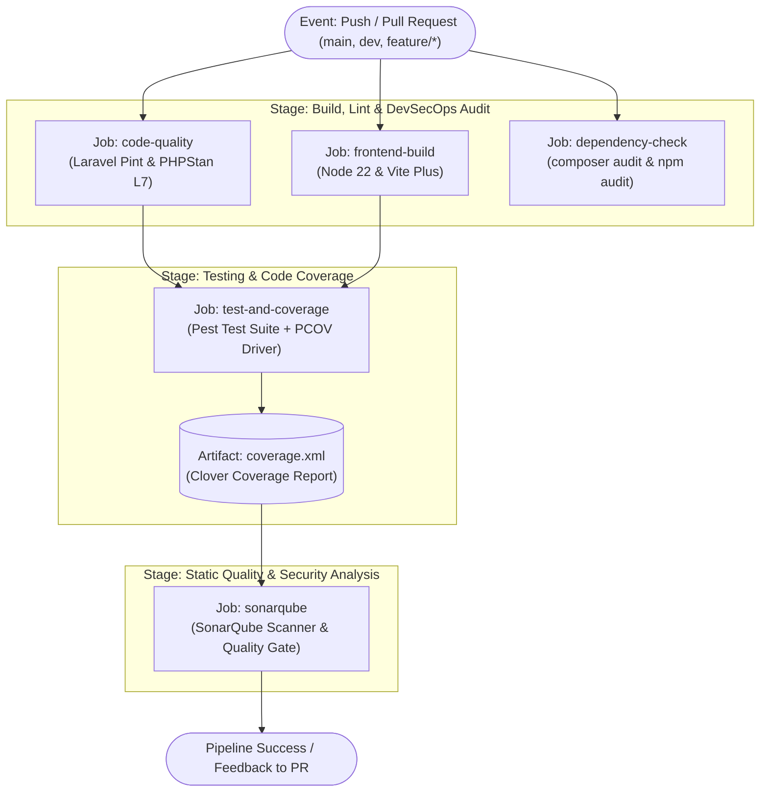

# Dokumentasi Pipeline CI/CD: Multi-Stage GitHub Actions

Dokumentasi ini menjelaskan konfigurasi dan alur kerja pipeline *Continuous Integration* (CI) dan *DevSecOps* yang diimplementasikan secara modular pada repositori ini menggunakan GitHub Actions melalui workflow-workflow terisolasi:
- **CI Workflows**:
  - [`.github/workflows/ci-code-quality.yml`](file:///Volumes/Caldera/CALDERA/PRIBADI/DevOps/blog-devops-ceria/.github/workflows/ci-code-quality.yml) (Laravel Pint & PHPStan Level 7)
  - [`.github/workflows/ci-frontend-build.yml`](file:///Volumes/Caldera/CALDERA/PRIBADI/DevOps/blog-devops-ceria/.github/workflows/ci-frontend-build.yml) (Vite Plus Asset Build)
  - [`.github/workflows/ci-testing.yml`](file:///Volumes/Caldera/CALDERA/PRIBADI/DevOps/blog-devops-ceria/.github/workflows/ci-testing.yml) (Pest 5 Automated Testing & PCOV Coverage)
  - [`.github/workflows/sonarcloud.yml`](file:///Volumes/Caldera/CALDERA/PRIBADI/DevOps/blog-devops-ceria/.github/workflows/sonarcloud.yml) (SonarCloud Code Quality & Gate)
- **DevSecOps Workflows (Sesuai Rubrik Evaluasi)**:
  - [`.github/workflows/devsecops-branch-protection.yml`](file:///Volumes/Caldera/CALDERA/PRIBADI/DevOps/blog-devops-ceria/.github/workflows/devsecops-branch-protection.yml) (PIC: Anggota 1 - Branch Protection)
  - [`.github/workflows/devsecops-composer-audit.yml`](file:///Volumes/Caldera/CALDERA/PRIBADI/DevOps/blog-devops-ceria/.github/workflows/devsecops-composer-audit.yml) (PIC: Anggota 2 - Backend Dependency)
  - [`.github/workflows/devsecops-npm-audit.yml`](file:///Volumes/Caldera/CALDERA/PRIBADI/DevOps/blog-devops-ceria/.github/workflows/devsecops-npm-audit.yml) (PIC: Anggota 3 - Frontend Dependency)
  - [`.github/workflows/devsecops-secret-scan.yml`](file:///Volumes/Caldera/CALDERA/PRIBADI/DevOps/blog-devops-ceria/.github/workflows/devsecops-secret-scan.yml) (PIC: Anggota 4 - Secret Management)
  - [`.github/workflows/sonarcloud.yml`](file:///Volumes/Caldera/CALDERA/PRIBADI/DevOps/blog-devops-ceria/.github/workflows/sonarcloud.yml) (PIC: Anggota 5 - SonarQube Quality Gate)
  - [`.github/workflows/devsecops-stride-tests.yml`](file:///Volumes/Caldera/CALDERA/PRIBADI/DevOps/blog-devops-ceria/.github/workflows/devsecops-stride-tests.yml) (PIC: Anggota 6 - STRIDE Threat Modeling)

---

## 🏗️ Arsitektur Pipeline Multi-Stage

Pipeline ini dirancang untuk mencapai kualifikasi **Sangat Baik (Skor 4)** pada Rubrik 1 Evaluasi UTS DevOps dengan menerapkan arsitektur *multi-stage* yang modular, terisolasi, dan memanfaatkan sistem *caching* dependensi.



---

## 📋 Rincian Tahapan (Jobs) Pipeline

### 1. Stage: Code Style & Static Analysis (`code-quality`)
- **Tujuan**: Memastikan integritas penulisan kode sesuai standar PSR/Laravel Pint serta melakukan validasi tipe data statis tingkat tinggi menggunakan Larastan/PHPStan.
- **Tools**:
  - PHP 8.4 dengan Composer v2.
  - `vendor/bin/pint --test`: Memeriksa format penulisan kode tanpa melakukan modifikasi langsung pada pipeline.
  - `vendor/bin/phpstan analyse --memory-limit=1G`: Memeriksa potensi bug, *null-safety*, dan *type mismatches* pada level 7.
- **Optimasi**: Menggunakan `actions/cache@v4` untuk folder `vendor` berbasis hash `composer.lock`.

### 2. Stage: Frontend Asset Build (`frontend-build`)
- **Tujuan**: Memverifikasi bahwa seluruh aset JavaScript, Tailwind CSS v4, dan komponen UI Blaze/Flux berhasil di-bundle tanpa kegagalan kompilasi.
- **Tools**:
  - PHP 8.4 dengan Composer v2 (untuk dependensi Flux UI CSS di `vendor/livewire/flux`).
  - Node.js versi 22.
  - `npm ci`: Menginstal dependensi NPM secara deterministik.
  - `npm run build`: Mengompilasi aset melalui Vite Plus (`vp build`).

### 3. Stage: DevSecOps Dependency Security Audit (`dependency-check`)
- **Tujuan**: Memindai kerentanan keamanan (*vulnerabilities*) pada paket dependensi *third-party* yang terdaftar pada ekosistem PHP dan Node.js serta memindai repositori dari kebocoran token/secret.
- **Tools**:
  - `composer audit --locked`: Memeriksa database kerentanan keamanan resmi *Packagist Advisory Database*.
  - `npm audit --audit-level=high`: Memeriksa kerentanan keamanan berisiko tinggi (*high/critical*) pada paket NPM.
  - `aquasecurity/trivy-action@v0.36.0`: Memindai kerentanan level HIGH & CRITICAL serta mendeteksi kebocoran *secret/credential*.

### 4. Stage: Automated Testing & Code Coverage (`test-and-coverage`)
- **Tujuan**: Menjalankan seluruh *unit test* dan *feature test* secara otomatis dalam lingkungan replikasi produksi, serta mengukur persentase *code coverage*.
- **Konfigurasi Lingkungan**:
  - PHP 8.4 dengan ekstensi lengkap (`mbstring`, `pdo_sqlite`, `intl`, dll.).
  - Ekstensi `pcov` aktif untuk kalkulasi coverage berkecepatan tinggi.
  - Database SQLite *in-memory* (`:memory:`) dan SQLite database file untuk isolasi penuh.
- **Command Utama**:
  ```bash
  vendor/bin/pest --coverage --coverage-clover=coverage.xml
  ```
- **Output Artifact**: File `coverage.xml` diunggah menggunakan `actions/upload-artifact@v4` agar dapat dianalisis oleh SonarQube pada tahapan berikutnya.

### 5. Stage: SonarQube Code Quality Analysis (`sonarqube`)
- **Tujuan**: Melakukan inspeksi kualitas kode otomatis, mendeteksi *bugs*, *vulnerabilities*, *code smells*, serta mengevaluasi *Quality Gate* berdasarkan data *coverage* dari tahap sebelumnya.
- **Konfigurasi**:
  - Mengunduh artefak `coverage.xml`.
  - Menjalankan `sonarsource/sonarqube-scan-action@v5` dengan parameter dari file [`sonar-project.properties`](file:///Volumes/Caldera/CALDERA/PRIBADI/DevOps/blog-devops-ceria/sonar-project.properties).
  - Terintegrasi dengan GitHub Secrets (`SONAR_TOKEN` dan `SONAR_HOST_URL`).

---

## ⚙️ Trigger Events & Filter Cabang (Branching)

Pipeline dikonfigurasi untuk aktif secara otomatis pada:
1. **Push**:
   - Branch `main` (Branch produksi)
   - Branch `dev` (Branch integrasi pengembangan)
   - Seluruh branch fitur dengan format `feature/**`
2. **Pull Request (PR)**:
   - Setiap PR yang menargetkan merge ke branch `main` atau `dev`.

Hal ini memastikan tidak ada kode yang dapat di-merge ke branch utama sebelum seluruh *automated checks* dan *tests* dinyatakan lulus (*Green*).
