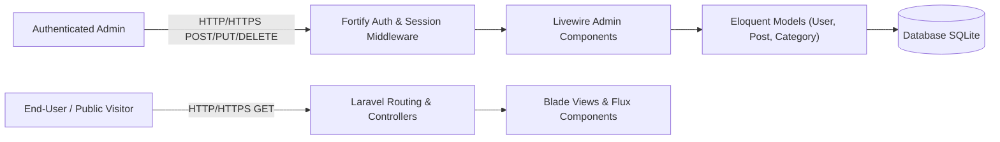

# Threat Modeling Keamanan Aplikasi: Framework STRIDE

Dokumen ini memuat analisis ancaman keamanan (*threat modeling*) untuk aplikasi **Blog DevOps Ceria** menggunakan metodologi **STRIDE** (*Spoofing*, *Tampering*, *Repudiation*, *Information Disclosure*, *Denial of Service*, *Elevation of Privilege*).

---

## 🎯 Ruang Lingkup & Arsitektur Aplikasi

Aplikasi Blog DevOps Ceria merupakan sistem manajemen konten dan publikasi artikel berbasis web dengan komponen arsitektur utama:
1. **Public Web Interface**: Halaman beranda daftar artikel dan detail postingan (`/blog/{post:slug}`).
2. **Authentication & Session Module**: Autentikasi Fortify (Login, Registrasi, Forgot Password, Reset Password, Konfirmasi Password).
3. **Admin Dashboard & Management**: Modul CRUD Manajemen Artikel (`posts`), Kategori (`categories`), dan Pengguna (`users`) via Livewire.
4. **Settings & Profile**: Pengaturan profil, ubah password, dan penghapusan akun.
5. **Database Layer**: Penyimpanan data pengguna, artikel, kategori, dan session token pada SQLite.

---

## 🛡️ Analisis Matriks STRIDE Lengkap

Berikut adalah analisis ancaman komprehensif untuk seluruh 6 kategori STRIDE yang dipetakan langsung ke komponen aplikasi Blog DevOps Ceria:

| No | Kategori STRIDE | Komponen Terdampak | Contoh Skenario Ancaman | Tingkat Risiko | Rekomendasi & Implementasi Mitigasi Teknis |
|:---:|:---|:---|:---|:---:|:---|
| **1** | **Spoofing** (Pemalsuan Identitas) | Authentication, Login Controller, Session Cookie | Penyerang memalsukan kredensial pengguna atau mencuri session cookie (`laravel_session`) untuk berpura-pura menjadi Admin. | **High** | - Implementasi hashing password menggunakan `Bcrypt` dengan cost factor aman. - Penggunaan cookie dengan atribut `HttpOnly`, `SameSite=lax`, dan `Secure` pada mode produksi. - Regenerasi ID sesi otomatis saat login (`$request->session()->regenerate()`) untuk mencegah *session fixation* via Fortify. - Rate limiting ketat pada endpoint autentikasi (`five per minute`). |
| **2** | **Tampering** (Modifikasi Data Ilegal) | Form Inputs, Livewire Component Action, Post Creation/Update | Penyerang memanipulasi parameter form/request untuk mengubah author artikel, status terbit, atau menyuntikkan script berbahaya (*Stored XSS*). | **Medium** | - Validasi ketat pada backend menggunakan Form Request / Livewire Validation rules (`required`, `string`, `max:255`, `exists:categories,id`). - Proteksi otomatis terhadap Cross-Site Scripting (XSS) melalui Blade auto-escaping `{{ $data }}`. - Perlindungan CSRF otomatis menggunakan Blade `@csrf` dan Livewire token verification. |
| **3** | **Repudiation** (Penyangkalan Aksi) | Audit Log, Post Deletion, User Management | Pengguna atau admin menyangkal telah menghapus artikel penting atau mengubah peran pengguna lain tanpa jejak. | **Medium** | - Implementasi event logging pada operasi kritis (misal: penghapusan artikel atau update user role). - Timestamping otomatis via Eloquent (`created_at`, `updated_at`, `deleted_at`). - Penyimpanan access log dan error log terpusat di `storage/logs/laravel.log`. |
| **4** | **Information Disclosure** (Kebocoran Data Sensitif) | Environment Config, Error Handler, API Response | Detail stack trace database, `APP_KEY`, atau credential sensitif terekspos ke publik saat terjadi *unhandled exception*. | **High** | - Memastikan `APP_DEBUG=false` pada lingkungan staging dan production. - Seluruh kredensial sensitif diisolasi ke dalam file `.env` dan diabaikan dari Git repository via [`.gitignore`](file:///Volumes/Caldera/CALDERA/PRIBADI/DevOps/blog-devops-ceria/.gitignore). - Penggunaan secret variables pada GitHub Actions (`secrets.SONAR_TOKEN`, dll.). - Penutupan header server informasi sensitif. |
| **5** | **Denial of Service** (DoS) | Public Endpoints, Authentication, File Upload | Penyerang membanjiri server dengan ribuan request login atau request baca artikel simultan sehingga layanan lumpuh. | **Medium** | - Penerapan middleware `throttle` (Rate Limiting) pada route publik dan autentikasi (`Route::middleware('throttle:60,1')`). - Validasi batasan ukuran payload dan pagination pada data list (`paginate(10)`). - Resource timeout limit pada proses eksekusi PHP. |
| **6** | **Elevation of Privilege** (Eskalasi Hak Akses) | Authorization, User Role (`admin` vs `user`), Routes | Pengguna biasa dengan peran `user` mencoba mengakses URL dashboard atau memicu method delete post melalui manipulasi parameter Livewire. | **High** | - Implementasi Role-Based Access Control (RBAC) dengan kolom `role` pada tabel `users`. - Pemeriksaan otorisasi di tingkat middleware dan controller (`abort_if(!auth()->user()->isAdmin(), 403)`). - Proteksi *Mass Assignment* dengan mendefinisikan `$fillable` secara eksplisit pada model `User`, `Post`, dan `Category`. |

---

## 🔍 Detail Mitigasi Spesifik pada Kode Aplikasi

### 1. Penanganan Privilege Escalation & Mass Assignment
Pada model [`app/Models/User.php`](file:///Volumes/Caldera/CALDERA/PRIBADI/DevOps/blog-devops-ceria/app/Models/User.php):
- Properti `$fillable` hanya mengizinkan atribut yang aman diisi oleh pengguna publik.
- Atribut `role` diamankan dan hanya dapat dimodifikasi oleh sistem otorisasi internal admin.

### 2. Validasi & Sanitasi Input pada Komponen Livewire
Pada komponen pembuatan artikel ([`app/Livewire/Admin/Posts/Create.php`](file:///Volumes/Caldera/CALDERA/PRIBADI/DevOps/blog-devops-ceria/app/Livewire/Admin/Posts/Create.php)):
- Aturan validasi didefinisikan secara deklaratif di backend, mencegah *Tampering* via modifikasi payload browser.
- Relasi artikel secara otomatis dikaitkan dengan `auth()->id()`, mencegah pengguna memalsukan *author* artikel (*Spoofing*).

---

## 🧪 Otomasi Pengujian Keamanan STRIDE pada Pipeline CI

Seluruh mitigasi 6 kategori STRIDE diuji secara otomatis menggunakan Pest test suite:
- **File Test**: [`tests/Feature/Security/StrideThreatModelingTest.php`](file:///Volumes/Caldera/CALDERA/PRIBADI/DevOps/blog-devops-ceria/tests/Feature/Security/StrideThreatModelingTest.php)
- **Workflow Pipeline**: [`.github/workflows/devsecops-stride-tests.yml`](file:///Volumes/Caldera/CALDERA/PRIBADI/DevOps/blog-devops-ceria/.github/workflows/devsecops-stride-tests.yml)

| Kode Test | Kategori STRIDE | Perilaku yang Diverifikasi Secara Otomatis |
|:---|:---|:---|
| `STRIDE-S` | **Spoofing** | Pengunjung tanpa autentikasi tidak dapat mengakses endpoint dashboard dan dipaksa redirect ke login. |
| `STRIDE-T` | **Tampering** | Validasi backend menolak payload kosong atau ID kategori ilegal (`exists:categories,id`). |
| `STRIDE-R` | **Repudiation** | Pembuatan dan update artikel mewajibkan kepemilikan author (`user_id`) dan timestamp audit (`created_at`, `updated_at`). |
| `STRIDE-I` | **Information Disclosure** | Kredensial pengguna (`password`, token) tersembunyi dari serialisasi, dan artikel draft tidak bisa dibuka publik (HTTP 404). |
| `STRIDE-D` | **Denial of Service** | Pengambilan artikel dibatasi oleh paginasi ketat (maksimal 9 artikel per halaman) mencegah *memory exhaustion*. |
| `STRIDE-E` | **Elevation of Privilege** | Pengguna unauthenticated ditolak dari seluruh route pengelolaan artikel, kategori, dan pengguna. |

