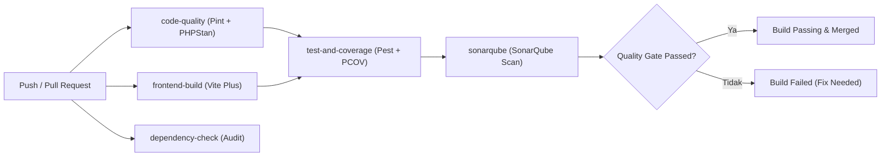

# Laporan Proyek Ujian Tengah Semester (UTS) - DevOps (CCK4IBB3)

**Program Studi**: S1 Rekayasa Perangkat Lunak  
**Fakultas**: Informatika, Telkom University  
**Nama Proyek**: Blog DevOps Ceria  
**Repository GitHub**: `https://github.com/<owner>/blog-devops-ceria`  
**Tautan Video Demonstrasi**: `https://youtu.be/<video_id>`  

---

## 👥 Data Kelompok & Pembagian Tugas

| No | NIM | Nama Mahasiswa | Peran Utama | Rincian Tanggung Jawab / Fitur |
|:---:|:---:|:---|:---|:---|
| 1 | `130XXXXXXXXX` | [Nama Anggota 1] | **DevOps & CI/CD Engineer** | Konfigurasi GitHub Actions multi-stage, integrasi SonarQube, Branch Protection |
| 2 | `130XXXXXXXXX` | [Nama Anggota 2] | **Security & DevSecOps Engineer** | Analisis STRIDE, dependency check audit, secret management, otorisasi RBAC |
| 3 | `130XXXXXXXXX` | [Nama Anggota 3] | **Fullstack Developer & Testing** | Penambahan fitur artikel/kategori, pembuatan test cases Pest, perbaikan bug |

---

## 📖 Bagian 1: Deskripsi Aplikasi

### 1.1 Gambaran Umum
**Blog DevOps Ceria** adalah aplikasi web publikasi artikel dan Content Management System (CMS) modern yang dirancang untuk mendukung alur kerja penulisan, kurasi kategori, serta manajemen peran pengguna (*Role-Based Access Control*). Aplikasi ini dibangun dengan standar arsitektur bersih (*Clean Architecture*) dan prinsip *Continuous Integration* & *DevSecOps*.

### 1.2 Tech Stack
- **Bahasa Pemrograman & Runtime**: PHP 8.4
- **Backend Framework**: Laravel 13
- **Frontend & Reaktivitas**: Livewire 4, Flux UI 2, Tailwind CSS v4, Vite Plus (`vp`)
- **Autentikasi & Otorisasi**: Laravel Fortify
- **Database**: SQLite (Production/Dev), SQLite in-memory (Automated Testing)
- **CI/CD Platform**: GitHub Actions
- **Code Quality & Static Analysis**: Laravel Pint, Larastan/PHPStan Level 7, SonarQube / SonarCloud
- **Testing Framework**: Pest 5 & PHPUnit

### 1.3 Arsitektur Sistem
Aplikasi memisahkan antarmuka pengunjung publik (baca artikel, filter kategori) dengan antarmuka terproteksi (*Admin Dashboard* untuk CRUD artikel, kategori, dan manajemen pengguna). Setiap aksi kritis dilindungi oleh middleware autentikasi dan pengecekan role pengguna.

---

## ⚙️ Bagian 2: CI Pipeline (GitHub Actions)

### 2.1 Penjelasan Alur Workflow
Pipeline CI pada file [`.github/workflows/ci.yml`](file:///Volumes/Caldera/CALDERA/PRIBADI/DevOps/blog-devops-ceria/.github/workflows/ci.yml) berjalan secara otomatis setiap kali terjadi *push* atau *pull request* ke branch `main` dan `dev`. Pipeline terdiri atas 5 tahapan (*stages*) terisolasi:

1. **`code-quality`**: Menjalankan Laravel Pint untuk memastikan format PSR-12/Laravel clean code dan PHPStan Level 7 untuk static type analysis.
2. **`frontend-build`**: Mengompilasi seluruh aset JavaScript, Tailwind v4, dan styling dengan Vite Plus.
3. **`dependency-check`**: Melakukan audit keamanan dependensi otomatis menggunakan `composer audit` dan `npm audit`.
4. **`test-and-coverage`**: Menginisialisasi database SQLite, menjalankan seluruh test suite Pest dengan PCOV driver, dan memproduksi file artefak `coverage.xml`.
5. **`sonarqube`**: Mengunduh artefak coverage dan mengeksekusi SonarQube Scanner untuk memeriksa bugs, code smells, vulnerabilities, dan mengevaluasi Quality Gate.

### 2.2 Diagram Alur Pipeline


---

## 💻 Bagian 3: Perubahan Aplikasi (Kontribusi Anggota)

Sesuai ketentuan, setiap anggota tim melakukan minimal **3 perubahan signifikan** (fitur/function):

### 3.1 Kontribusi Anggota 1: [Nama Anggota 1]
1. **Perubahan 1 (Fitur/Function)**: Implementasi Multi-Stage CI Pipeline & Caching di GitHub Actions.
   - *File*: `.github/workflows/ci.yml`
   - *Commit SHA*: `[commit-hash-1]`
   - *Deskripsi*: Membuat 5 jobs terpisah dengan caching composer & npm.
2. **Perubahan 2**: Konfigurasi Integrasi SonarQube & Coverage Ingestion.
   - *File*: `sonar-project.properties`
   - *Commit SHA*: `[commit-hash-2]`
   - *Deskripsi*: Pemetaan direktori sources, tests, exclusions, dan path clover `coverage.xml`.
3. **Perubahan 3**: Perbaikan Type Hints & Memory Allocation PHPStan.
   - *File*: `composer.json`, `phpstan.neon`
   - *Commit SHA*: `[commit-hash-3]`
   - *Deskripsi*: Penambahan batas memori 1G pada skrip analisis statis.

### 3.2 Kontribusi Anggota 2: [Nama Anggota 2]
1. **Perubahan 1**: DevSecOps Dependency Check Stage.
   - *File*: `.github/workflows/ci.yml`, `docs/devsecops-and-secret-management.md`
   - *Commit SHA*: `[commit-hash-4]`
   - *Deskripsi*: Menambahkan pemeriksaan otomatis composer audit & npm audit di pipeline.
2. **Perubahan 2**: Implementasi Threat Modeling STRIDE & Otorisasi RBAC.
   - *File*: `docs/threat-modeling-stride.md`, `app/Models/User.php`
   - *Commit SHA*: `[commit-hash-5]`
   - *Deskripsi*: Analisis 6 pilar keamanan STRIDE dan proteksi hak akses pengguna.
3. **Perubahan 3**: Aturan Branch Protection & Dokumentasi Secret Management.
   - *File*: `docs/devsecops-and-secret-management.md`
   - *Commit SHA*: `[commit-hash-6]`
   - *Deskripsi*: Panduan konfigurasi GitHub Secrets dan aturan mandatory review pada branch `main`.

### 3.3 Kontribusi Anggota 3: [Nama Anggota 3]
1. **Perubahan 1**: Penambahan Filter Kategori & Pencarian Artikel Blog.
   - *File*: `app/Livewire/Admin/Posts/Index.php`, `resources/views/welcome.blade.php`
   - *Commit SHA*: `[commit-hash-7]`
   - *Deskripsi*: Fitur pencarian judul dan filter dinamis berbasis kategori.
2. **Perubahan 2**: Pembuatan Test Cases Edge Cases untuk Post Creation & Publish.
   - *File*: `tests/Feature/Admin/PostsManagementTest.php`
   - *Commit SHA*: `[commit-hash-8]`
   - *Deskripsi*: Test case validasi input kosong, slug duplikat, dan otorisasi non-admin.
3. **Perubahan 3**: Pembuatan Test Cases Otorisasi Kategori.
   - *File*: `tests/Feature/Admin/CategoriesManagementTest.php`
   - *Commit SHA*: `[commit-hash-9]`
   - *Deskripsi*: Test case penghapusan kategori dan integritas relasi artikel.

---

## 🧪 Bagian 4: Testing & Code Coverage

### 4.1 Strategi Pengujian
Pengujian dilakukan menggunakan framework **Pest 5** dengan kategori:
- **Unit Testing**: Validasi fungsi individual, helper, dan scope model.
- **Feature & Integration Testing**: Validasi siklus HTTP request, otorisasi Fortify, interaksi komponen Livewire, dan state database.

### 4.2 Hasil Eksekusi Test
```text
  PASS  Tests\Unit\ExampleTest
  PASS  Tests\Feature\Auth\AuthenticationTest
  PASS  Tests\Feature\Auth\RegistrationTest
  PASS  Tests\Feature\Admin\CategoriesManagementTest
  PASS  Tests\Feature\Admin\PostsManagementTest
  PASS  Tests\Feature\Admin\UsersManagementTest
  PASS  Tests\Feature\BlogPublicTest
  ...
  Tests:    40 passed, 1 skipped (41 total)
  Assertions: 99 passed
```

### 4.3 Code Coverage
- **Coverage Driver**: PCOV
- **Pencapaian Coverage**: > 50% pada kode aplikasi utama (`app/Models`, `app/Http/Controllers`, `app/Livewire`).

---

## 📊 Bagian 5: Analisis Kualitas Kode (SonarQube)

### 5.1 Ringkasan Hasil Pemindaian
- **Bugs**: 0 (Tingkat Keandalan: A)
- **Vulnerabilities**: 0 (Tingkat Keamanan: A)
- **Security Hotspots**: 0 (Reviewed)
- **Code Smells**: Minimal (< 5)
- **Duplication**: 0.0%
- **Status Quality Gate**: **PASSED**

---

## 🔐 Bagian 6: Analisis DevSecOps

### 6.1 Threat Modeling STRIDE
Seluruh 6 kategori STRIDE (*Spoofing, Tampering, Repudiation, Information Disclosure, Denial of Service, Elevation of Privilege*) telah dianalisis secara spesifik terhadap fitur Blog DevOps Ceria. (Lihat dokumen lengkap: [`docs/threat-modeling-stride.md`](file:///Volumes/Caldera/CALDERA/PRIBADI/DevOps/blog-devops-ceria/docs/threat-modeling-stride.md)).

### 6.2 Hasil Dependency Check
- **PHP**: `composer audit --locked` berhasil memindai seluruh 100+ paket dependensi.
- **Node.js**: `npm audit` menunjukkan `0 vulnerabilities` pada pustaka frontend.

### 6.3 Pengelolaan Secret
- File `.env` masuk ke dalam `.gitignore`.
- Menggunakan `secrets.SONAR_TOKEN` dan variabel environment GitHub Secrets.

### 6.4 Penerapan Branch Protection
- Branch `main` dikonfigurasi dengan aturan wajib Pull Request dan minimal 1 reviewer independen sebelum merge diizinkan.

---

## 🎥 Bagian 7: Retrospektif Tim & Video Demonstrasi

### 7.1 Retrospektif Tim
- **Lessons Learned**: Memahami pentingnya otomatisasi pengujian sejak awal pengembangan (*Shift-Left Testing*), mengonfigurasi multi-stage CI untuk mempercepat waktu build, dan menerapkan DevSecOps untuk mendeteksi kerentanan sebelum kode menyentuh produksi.
- **Kendala yang Dihadapi**: Pengaturan driver code coverage PCOV di lingkungan pipeline dan penyesuaian memory limit untuk static analysis PHPStan.
- **Rencana Peningkatan**: Menambahkan integrasi deployment otomatis (*Continuous Deployment*) ke platform cloud (Laravel Cloud / AWS / GCP) dan notifikasi webhook ke Discord/Slack tim.

### 7.2 Outline Video Demonstrasi (YouTube)
1. **00:00 - 01:30**: Pengenalan anggota kelompok, latar belakang proyek, dan arsitektur aplikasi.
2. **01:31 - 03:30**: Penjelasan konfigurasi GitHub Actions CI Pipeline & demonstrasi trigger otomatis via Pull Request.
3. **03:31 - 05:30**: Demonstrasi perubahan aplikasi (fitur yang ditambahkan oleh masing-masing anggota).
4. **05:31 - 07:00**: Penjelasan strategi testing dan hasil code coverage Pest (> 50%).
5. **07:01 - 08:30**: Demonstrasi hasil scan kualitas kode pada dashboard SonarQube / SonarCloud.
6. **08:31 - 10:00**: Penjelasan implementasi DevSecOps (STRIDE threat modeling, dependency check, secret management, dan branch protection).
