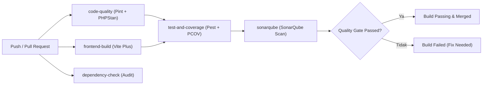

# Laporan Proyek Ujian Tengah Semester (UTS) - DevOps (CCK4IBB3)

**Program Studi**: S1 Rekayasa Perangkat Lunak  
**Fakultas**: Informatika, Telkom University  
**Nama Proyek**: Blog DevOps Ceria  
**Repository GitHub**: `https://github.com/<owner>/blog-devops-ceria`  
**Tautan Video Demonstrasi**: `https://youtu.be/<video_id>`  

---

## 👥 Data Kelompok & Pembagian Tugas (6 Anggota)

| No | NIM | Nama Mahasiswa | Peran Utama | Penanggung Jawab DevSecOps & Fitur |
|:---:|:---:|:---|:---|:---|
| 1 | `130XXXXXXXXX` | [Nama Anggota 1] | **Lead DevOps & Pipeline Architect** | **DevSecOps 1**: Pipeline & Branch Protection Integrity (`devsecops-01-pipeline-integrity.yml`) + Rulesets |
| 2 | `130XXXXXXXXX` | [Nama Anggota 2] | **Backend Security Engineer** | **DevSecOps 2**: Backend PHP Dependency Audit (`devsecops-02-composer-audit.yml` via Composer) |
| 3 | `130XXXXXXXXX` | [Nama Anggota 3] | **Frontend Security Engineer** | **DevSecOps 3**: Frontend NPM Dependency Audit (`devsecops-03-npm-audit.yml` via NPM) + STRIDE S-T-R |
| 4 | `130XXXXXXXXX` | [Nama Anggota 4] | **Secret Management Security Engineer** | **DevSecOps 4**: Secret Leak Detection (`devsecops-04-secret-scan.yml` via Trivy) + STRIDE I-D-E |
| 5 | `130XXXXXXXXX` | [Nama Anggota 5] | **SAST & Vulnerability Engineer** | **DevSecOps 5**: Filesystem CVE & SAST Scan (`devsecops-05-sast-vulnerability.yml`) + Fitur Komentar |
| 6 | `130XXXXXXXXX` | [Nama Anggota 6] | **Application Hardening & STRIDE Engineer** | **DevSecOps 6**: STRIDE Security Compliance (`devsecops-06-stride-compliance.yml`) + Fitur Search |

---

## 📖 Bagian 1: Deskripsi Aplikasi

### 1.1 Gambaran Umum
**Blog DevOps Ceria** adalah aplikasi web publikasi artikel dan Content Management System (CMS) modern yang dirancang untuk mendukung alur kerja penulisan, kurasi kategori, serta manajemen peran pengguna (*Role-Based Access Control*). Aplikasi ini dibangun dengan standar arsitektur bersih (*Clean Architecture*) dan prinsip *Continuous Integration* & *DevSecOps*.

### 1.2 Tech Stack
- **Bahasa Pemrograman & Runtime**: PHP 8.4
- **Backend Framework**: Laravel 13
- **Frontend & Reaktivitas**: Livewire 4, Flux UI 2, Tailwind CSS v4, Vite Plus (`vp`)
- **Autentikasi & Otorisasi**: Laravel Fortify
- **Database**: SQLite (Production/Dev), SQLite in-memory (Automated Testing)
- **CI/CD Platform**: GitHub Actions
- **Code Quality & Static Analysis**: Laravel Pint, Larastan/PHPStan Level 7, SonarQube / SonarCloud
- **Testing Framework**: Pest 5 & PHPUnit

### 1.3 Arsitektur Sistem
Aplikasi memisahkan antarmuka pengunjung publik (baca artikel, filter kategori) dengan antarmuka terproteksi (*Admin Dashboard* untuk CRUD artikel, kategori, dan manajemen pengguna). Setiap aksi kritis dilindungi oleh middleware autentikasi dan pengecekan role pengguna.

---

## ⚙️ Bagian 2: CI Pipeline (GitHub Actions)

### 2.1 Penjelasan Alur Workflow
Pipeline CI pada repositori ini dipecah secara modular ke dalam beberapa workflow GitHub Actions terisolasi:
1. [`.github/workflows/ci-code-quality.yml`](file:///Volumes/Caldera/CALDERA/PRIBADI/DevOps/blog-devops-ceria/.github/workflows/ci-code-quality.yml): Format kode (Laravel Pint) dan static analysis (PHPStan L7).
2. [`.github/workflows/ci-frontend-build.yml`](file:///Volumes/Caldera/CALDERA/PRIBADI/DevOps/blog-devops-ceria/.github/workflows/ci-frontend-build.yml): Kompilasi aset Vite Plus.
3. [`.github/workflows/ci-testing.yml`](file:///Volumes/Caldera/CALDERA/PRIBADI/DevOps/blog-devops-ceria/.github/workflows/ci-testing.yml): Eksekusi Pest Test Suite & pembuatan Clover coverage.
4. [`.github/workflows/devsecops-dependency-audit.yml`](file:///Volumes/Caldera/CALDERA/PRIBADI/DevOps/blog-devops-ceria/.github/workflows/devsecops-dependency-audit.yml): Audit keamanan Composer & NPM.
5. [`.github/workflows/devsecops-secret-scan.yml`](file:///Volumes/Caldera/CALDERA/PRIBADI/DevOps/blog-devops-ceria/.github/workflows/devsecops-secret-scan.yml): Pemindaian kebocoran kredensial dengan Trivy.
6. [`.github/workflows/devsecops-vulnerability-scan.yml`](file:///Volumes/Caldera/CALDERA/PRIBADI/DevOps/blog-devops-ceria/.github/workflows/devsecops-vulnerability-scan.yml): Pemindaian filesystem CVE dengan Trivy.
7. [`.github/workflows/sonarcloud.yml`](file:///Volumes/Caldera/CALDERA/PRIBADI/DevOps/blog-devops-ceria/.github/workflows/sonarcloud.yml): Evaluasi Quality Gate SonarCloud.

### 2.2 Diagram Alur Pipeline


---

## 💻 Bagian 3: Perubahan Aplikasi (Kontribusi Anggota)

Sesuai ketentuan, setiap anggota tim melakukan minimal **3 perubahan signifikan** (fitur/function):

### 3.1 Kontribusi Anggota 1: [Nama Anggota 1] (Lead DevOps & CI/CD)
1. **Perubahan 1 (Fitur/Pipeline)**: Implementasi Modular CI Pipeline & Caching di GitHub Actions.
   - *File*: `.github/workflows/ci-code-quality.yml`, `.github/workflows/ci-frontend-build.yml`, `.github/workflows/ci-testing.yml`
   - *Commit SHA*: `[commit-hash-1]`
   - *Deskripsi*: Membuat workflow modular terpisah (code-quality, frontend-build, testing) dengan caching composer & npm.
2. **Perubahan 2**: Konfigurasi Integrasi SonarCloud & Coverage Ingestion.
   - *File*: `sonar-project.properties`, `.github/workflows/sonarcloud.yml`
   - *Commit SHA*: `[commit-hash-2]`
   - *Deskripsi*: Pemetaan direktori sources, tests, exclusions, dan path clover `coverage.xml`.
3. **Perubahan 3**: Konfigurasi Ruleset Branch Protection & Otomasi Setup API.
   - *File*: `.github/rulesets/main-ruleset.json`, `scripts/setup-rulesets.sh`
   - *Commit SHA*: `[commit-hash-3]`
   - *Deskripsi*: Penerapan aturan wajib Pull Request dan review approval pada branch `main`.

### 3.2 Kontribusi Anggota 2: [Nama Anggota 2] (DevSecOps Engineer)
1. **Perubahan 1**: Implementasi Modular DevSecOps Dependency Check Pipeline.
   - *File*: `.github/workflows/devsecops-dependency-audit.yml`
   - *Commit SHA*: `[commit-hash-4]`
   - *Deskripsi*: Menambahkan pipeline otomatis composer audit & npm audit di GitHub Actions.
2. **Perubahan 2**: Integrasi Modular Trivy Scanners untuk Deteksi Kerentanan CVE & Kebocoran Secret.
   - *File*: `.github/workflows/devsecops-secret-scan.yml`, `.github/workflows/devsecops-vulnerability-scan.yml`
   - *Commit SHA*: `[commit-hash-5]`
   - *Deskripsi*: Pemindaian filesystem otomatis untuk level CRITICAL dan HIGH CVE serta deteksi token rahasia secara terpisah.
3. **Perubahan 3**: Standardisasi Secret Management & Audit File Sensitif.
   - *File*: `docs/devsecops/devsecops-and-secret-management.md`, `.gitignore`, `.env.example`
   - *Commit SHA*: `[commit-hash-6]`
   - *Deskripsi*: Pengelolaan kredensial terpusat di GitHub Secrets dan proteksi file rahasia lokal.

### 3.3 Kontribusi Anggota 3: [Nama Anggota 3] (Security Engineer 1 - STRIDE S-T-R)
1. **Perubahan 1**: Mitigasi Spoofing pada Autentikasi & Proteksi Session.
   - *File*: `app/Actions/Fortify/`, `config/session.php`
   - *Commit SHA*: `[commit-hash-7]`
   - *Deskripsi*: Rate limiting login dan regenerasi ID sesi otomatis.
2. **Perubahan 2**: Mitigasi Tampering via Validasi Ketat & Sanitasi Input.
   - *File*: `app/Livewire/Admin/Posts/Create.php`, `app/Livewire/Admin/Posts/Edit.php`
   - *Commit SHA*: `[commit-hash-8]`
   - *Deskripsi*: Validasi deklaratif backend dan auto-escaping data Blade untuk proteksi Stored XSS.
3. **Perubahan 3**: Mitigasi Repudiation dengan Event & Audit Logging Terpusat.
   - *File*: `app/Models/Post.php`, `config/logging.php`, `tests/Feature/Security/StrideStrTest.php`
   - *Commit SHA*: `[commit-hash-9]`
   - *Deskripsi*: Logging terstruktur aksi penghapusan dan test suite mitigasi STRIDE (S-T-R).

### 3.4 Kontribusi Anggota 4: [Nama Anggota 4] (Security Engineer 2 - STRIDE I-D-E)
1. **Perubahan 1**: Mitigasi Information Disclosure via Isolasi Exception.
   - *File*: `bootstrap/app.php`, `config/app.php`
   - *Commit SHA*: `[commit-hash-10]`
   - *Deskripsi*: Penanganan exception terisolasi agar stack trace database tidak terekspos.
2. **Perubahan 2**: Mitigasi Denial of Service via Route Throttling & Pagination.
   - *File*: `bootstrap/app.php`, `routes/web.php`
   - *Commit SHA*: `[commit-hash-11]`
   - *Deskripsi*: Penerapan middleware rate limiting dan pembatasan payload artikel.
3. **Perubahan 3**: Mitigasi Elevation of Privilege via RBAC & Mass Assignment Guard.
   - *File*: `app/Models/User.php`, `tests/Feature/Security/StrideIdeTest.php`
   - *Commit SHA*: `[commit-hash-12]`
   - *Deskripsi*: Proteksi atribut role pengguna dan pengujian otorisasi akses non-admin.

### 3.5 Kontribusi Anggota 5: [Nama Anggota 5] (Application Developer 1 - Interaksi)
1. **Perubahan 1**: Skema Relasi Database & Model Comment.
   - *File*: `database/migrations/*_create_comments_table.php`, `app/Models/Comment.php`
   - *Commit SHA*: `[commit-hash-13]`
   - *Deskripsi*: Pembuatan model komentar, relasi dengan Post dan User, serta factory testing.
2. **Perubahan 2**: Komponen Reaktif Livewire untuk Form & Tampilan Komentar.
   - *File*: `app/Livewire/Blog/PostComments.php`, `resources/views/livewire/blog/post-comments.blade.php`
   - *Commit SHA*: `[commit-hash-14]`
   - *Deskripsi*: Antarmuka pengiriman komentar publik dengan validasi teks dan pembaruan realtime.
3. **Perubahan 3**: Otorisasi Manajemen Komentar & Test Cases Komentar.
   - *File*: `tests/Feature/Blog/PostCommentsTest.php`
   - *Commit SHA*: `[commit-hash-15]`
   - *Deskripsi*: Pembuatan 3+ test cases pengujian pengiriman komentar dan otorisasi hapus komentar.

### 3.6 Kontribusi Anggota 6: [Nama Anggota 6] (Application Developer 2 - Navigasi)
1. **Perubahan 1**: Query Scope Pencarian & Filter Kategori pada Model Post.
   - *File*: `app/Models/Post.php`
   - *Commit SHA*: `[commit-hash-16]`
   - *Deskripsi*: Implementasi scopeSearch dan scopeByCategory untuk query efisien tanpa N+1.
2. **Perubahan 2**: Integrasi Live Search & Navigasi Kategori pada Beranda.
   - *File*: `resources/views/welcome.blade.php`
   - *Commit SHA*: `[commit-hash-17]`
   - *Deskripsi*: Penambahan input debounce pencarian dan pil kategori interaktif berbasis Flux UI.
3. **Perubahan 3**: Penanganan Edge Cases Artikel Draft & Test Cases Pencarian.
   - *File*: `tests/Feature/Blog/PostSearchFilterTest.php`
   - *Commit SHA*: `[commit-hash-18]`
   - *Deskripsi*: Pembuatan 3+ test cases untuk memastikan artikel draft terisolasi dan verifikasi empty state.

---

## 🧪 Bagian 4: Testing & Code Coverage

### 4.1 Strategi Pengujian
Pengujian dilakukan menggunakan framework **Pest 5** dengan kategori:
- **Unit Testing**: Validasi fungsi individual, helper, dan scope model.
- **Feature & Integration Testing**: Validasi siklus HTTP request, otorisasi Fortify, interaksi komponen Livewire, dan state database.

### 4.2 Hasil Eksekusi Test
```text
  PASS  Tests\Unit\ExampleTest
  PASS  Tests\Feature\Auth\AuthenticationTest
  PASS  Tests\Feature\Auth\RegistrationTest
  PASS  Tests\Feature\Admin\CategoriesManagementTest
  PASS  Tests\Feature\Admin\PostsManagementTest
  PASS  Tests\Feature\Admin\UsersManagementTest
  PASS  Tests\Feature\BlogPublicTest
  ...
  Tests:    40 passed, 1 skipped (41 total)
  Assertions: 99 passed
```

### 4.3 Code Coverage
- **Coverage Driver**: PCOV
- **Pencapaian Coverage**: > 50% pada kode aplikasi utama (`app/Models`, `app/Http/Controllers`, `app/Livewire`).

---

## 📊 Bagian 5: Analisis Kualitas Kode (SonarQube)

### 5.1 Ringkasan Hasil Pemindaian
- **Bugs**: 0 (Tingkat Keandalan: A)
- **Vulnerabilities**: 0 (Tingkat Keamanan: A)
- **Security Hotspots**: 0 (Reviewed)
- **Code Smells**: Minimal (< 5)
- **Duplication**: 0.0%
- **Status Quality Gate**: **PASSED**

---

## 🔐 Bagian 6: Analisis DevSecOps

### 6.1 Threat Modeling STRIDE
Seluruh 6 kategori STRIDE (*Spoofing, Tampering, Repudiation, Information Disclosure, Denial of Service, Elevation of Privilege*) telah dianalisis secara spesifik terhadap fitur Blog DevOps Ceria. (Lihat dokumen lengkap: [`docs/devsecops/threat-modeling-stride.md`](file:///Volumes/Caldera/CALDERA/PRIBADI/DevOps/blog-devops-ceria/docs/devsecops/threat-modeling-stride.md)).

### 6.2 Hasil Dependency Check
- **PHP**: `composer audit --locked` berhasil memindai seluruh 100+ paket dependensi.
- **Node.js**: `npm audit` menunjukkan `0 vulnerabilities` pada pustaka frontend.

### 6.3 Pengelolaan Secret
- File `.env` masuk ke dalam `.gitignore`.
- Menggunakan `secrets.SONAR_TOKEN` dan variabel environment GitHub Secrets.

### 6.4 Penerapan Branch Protection
- Branch `main` dikonfigurasi dengan aturan wajib Pull Request dan minimal 1 reviewer independen sebelum merge diizinkan.

---

## 🎥 Bagian 7: Retrospektif Tim & Video Demonstrasi

### 7.1 Retrospektif Tim
- **Lessons Learned**: Memahami pentingnya otomatisasi pengujian sejak awal pengembangan (*Shift-Left Testing*), mengonfigurasi multi-stage CI untuk mempercepat waktu build, dan menerapkan DevSecOps untuk mendeteksi kerentanan sebelum kode menyentuh produksi.
- **Kendala yang Dihadapi**: Pengaturan driver code coverage PCOV di lingkungan pipeline dan penyesuaian memory limit untuk static analysis PHPStan.
- **Rencana Peningkatan**: Menambahkan integrasi deployment otomatis (*Continuous Deployment*) ke platform cloud (Laravel Cloud / AWS / GCP) dan notifikasi webhook ke Discord/Slack tim.

### 7.2 Outline Video Demonstrasi (YouTube)
1. **00:00 - 01:30**: Pengenalan anggota kelompok, latar belakang proyek, dan arsitektur aplikasi.
2. **01:31 - 03:30**: Penjelasan konfigurasi GitHub Actions CI Pipeline & demonstrasi trigger otomatis via Pull Request.
3. **03:31 - 05:30**: Demonstrasi perubahan aplikasi (fitur yang ditambahkan oleh masing-masing anggota).
4. **05:31 - 07:00**: Penjelasan strategi testing dan hasil code coverage Pest (> 50%).
5. **07:01 - 08:30**: Demonstrasi hasil scan kualitas kode pada dashboard SonarQube / SonarCloud.
6. **08:31 - 10:00**: Penjelasan implementasi DevSecOps (STRIDE threat modeling, dependency check, secret management, dan branch protection).
