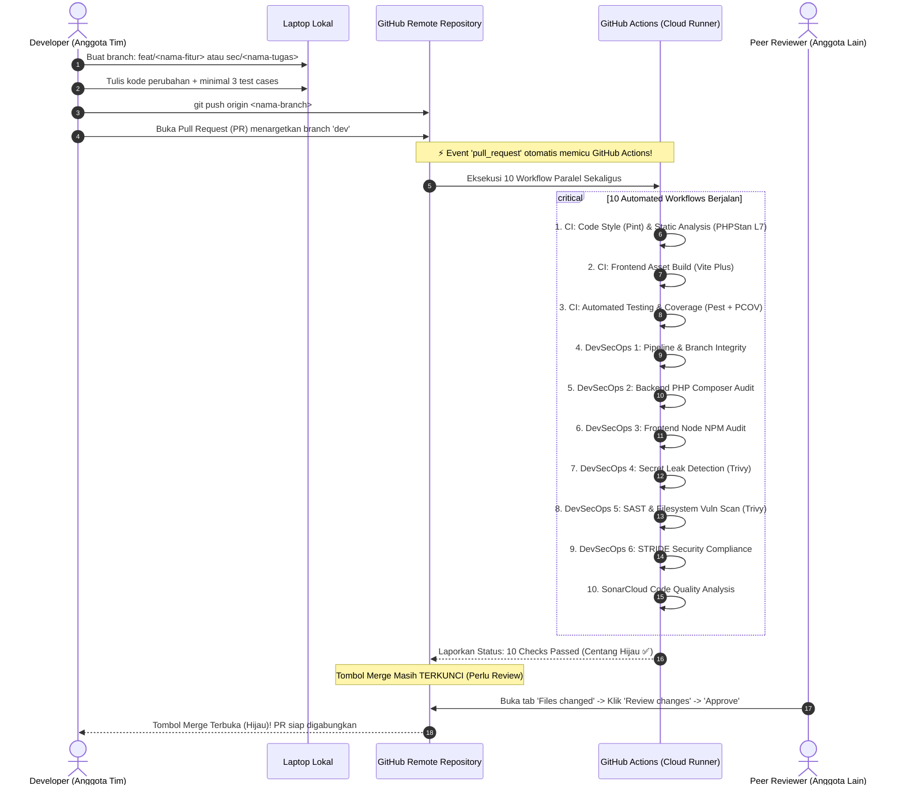

# 🚀 Panduan Workflow Otomasi CI/CD & Kolaborasi Tim

Dokumen ini merupakan panduan praktis alur kerja kolaborasi tim Blog DevOps Ceria. Panduan ini menjelaskan bagaimana setiap perubahan kode yang dilakukan oleh anggota tim secara otomatis diuji, diaudit keamanannya, dan dilindungi oleh sistem GitHub Actions & Branch Protection.

---

## ⚡ 1. Cara Kerja Sistem Otomasi (Tanpa Setup Lokal Tambahan)

Sistem CI/CD dan DevSecOps pada proyek ini berjalan **100% otomatis di server cloud GitHub**. Rekan tim **tidak perlu** menginstall GitHub runner atau software scanner khusus di laptop mereka:



---

## 🔄 2. Langkah Demi Langkah Developer Bekerja

### Langkah 1: Tarik Pembaruan dari Branch `dev`
Sebelum mulai ngoding, pastikan branch lokal sinkron dengan remote:
```bash
git checkout dev
git pull origin dev
```

### Langkah 2: Buat Branch Baru untuk Tugas Masing-Masing
Gunakan format nama branch yang deskriptif:
- Format fitur aplikasi: `feat/<nama-fitur>` (contoh: `feat/comment-system`, `feat/search-filter`)
- Format keamanan: `sec/<nama-keamanan>` (contoh: `sec/composer-audit-patch`, `sec/stride-hardening`)
```bash
git checkout -b feat/comment-system
```

### Langkah 3: Koding & Pembuatan Test Case
- Buka file blueprint Anda di folder [`docs/blueprints/`](file:///Volumes/Caldera/CALDERA/PRIBADI/DevOps/blog-devops-ceria/docs/blueprints/) sebagai acuan.
- Kerjakan perubahan kode sesuai tugas.
- Tulis **minimal 3 test cases** di direktori `tests/Feature/`.
- Jalankan verifikasi lokal sebelum push:
  ```bash
  vendor/bin/pint --test
  vendor/bin/pest
  ```

### Langkah 4: Commit dan Push ke GitHub
Lakukan commit dengan pesan yang jelas (format *Conventional Commits*):
```bash
git add .
git commit -m "feat(comment): build reactive comments component and pest test suite"
git push origin feat/comment-system
```

### Langkah 5: Buka Pull Request (PR) ke Branch `dev`
1. Buka repositori GitHub di browser.
2. Klik tombol hijau **Compare & pull request**.
3. Pastikan *base branch* mengarah ke **`dev`** (bukan langsung ke `main`).
4. Isi judul dan ringkasan perubahan pada form PR, lalu klik **Create pull request**.

---

## 🛠️ 3. Siklus Koreksi Otomatis Jika Terjadi Error

Jika kodingan Anda tidak lulus (misal: ada test case gagal atau format kode salah):
1. **GitHub Otomatis Menolak Merge (❌)**:
   - Status check yang bermasalah akan bertanda silang merah.
   - Tombol **"Merge pull request" otomatis terkunci (abu-abu / disabled)**. Branch `dev` tetap terlindungi dari kode rusak.
2. **Lihat Detail Error**:
   - Klik tulisan **Details** di samping job yang merah untuk membaca baris error.
3. **Perbaiki di Laptop**:
   - Perbaiki kode di editor Anda.
   - Lakukan commit dan push ulang ke branch yang sama:
     ```bash
     git add .
     git commit -m "fix(comment): resolve assertion error on empty input test"
     git push origin feat/comment-system
     ```
4. **Pipeline Mengulang Otomatis**:
   - GitHub mendeteksi commit baru dan langsung menjalankan ulang seluruh 10 workflow secara otomatis.
   - Anda **tidak perlu** membuat Pull Request baru.

---

## 🛡️ 4. Prosedur Code Review & Approval (Wajib oleh Anggota Lain)

Sesuai aturan **Branch Protection** (Rubrik 3 Poin 4):
1. Anggota tim lain (bukan pembuat PR) membuka halaman PR di GitHub.
2. Masuk ke tab **Files changed** di bagian atas.
3. Periksa perubahan baris kode (hijau = tambah, merah = hapus).
4. Klik tombol hijau **Review changes** di pojok kanan atas.
5. Tulis komentar singkat (misal: *"Kode bersih dan test suite lulus semua, approved."*).
6. Pilih opsi radio button **Approve**, lalu klik **Submit review**.
7. Tangkapan layar (*screenshot*) halaman review ini disimpan untuk dilampirkan pada **Bab 6 Laporan Proyek**.

---

## 💬 5. Template Pesan Siap Salin untuk Grup WhatsApp Tim

Anda dapat langsung menyalin pesan di bawah ini untuk dibagikan ke grup tim:

```text
Halo rekan-rekan tim DevOps,
Blueprint proyek dan otomasi DevSecOps kita sudah aktif di branch dev!

Alur kerja kita sangat simpel:
1. Tarik branch terbaru: git checkout dev && git pull origin dev
2. Bikin branch baru: git checkout -b feat/nama-fitur-kalian (atau sec/nama-tugas)
3. Buka panduan tugas masing-masing di folder docs/blueprints/
4. Kerjakan minimal 3 perubahan + minimal 3 test cases Pest
5. Push kodingan kalian: git push origin nama-branch-kalian
6. Buka Pull Request (PR) ke branch dev di GitHub.

Seluruh 10 workflow CI/CD dan DevSecOps akan jalan otomatis di GitHub (tidak perlu install apa-apa lagi di laptop). Kalau semua check sudah centang hijau, minta 1 teman tim untuk klik 'Review changes' -> 'Approve' sebelum di-merge.

Semangat! 🚀
```
